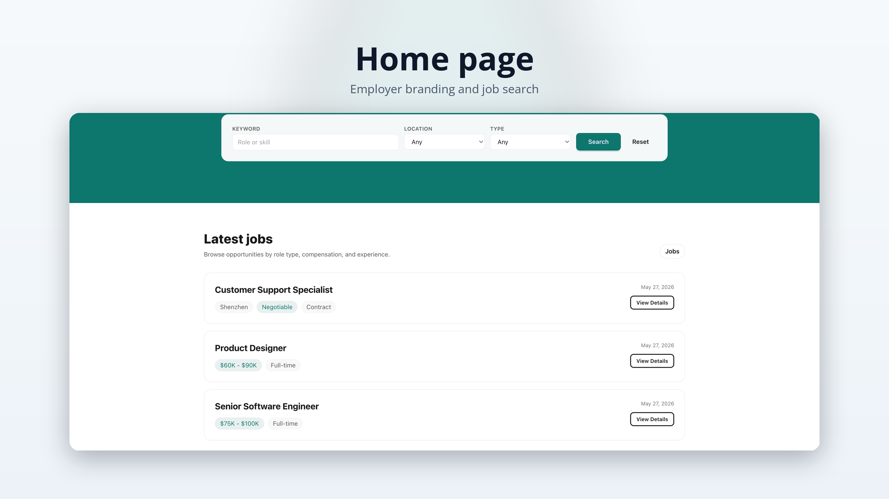
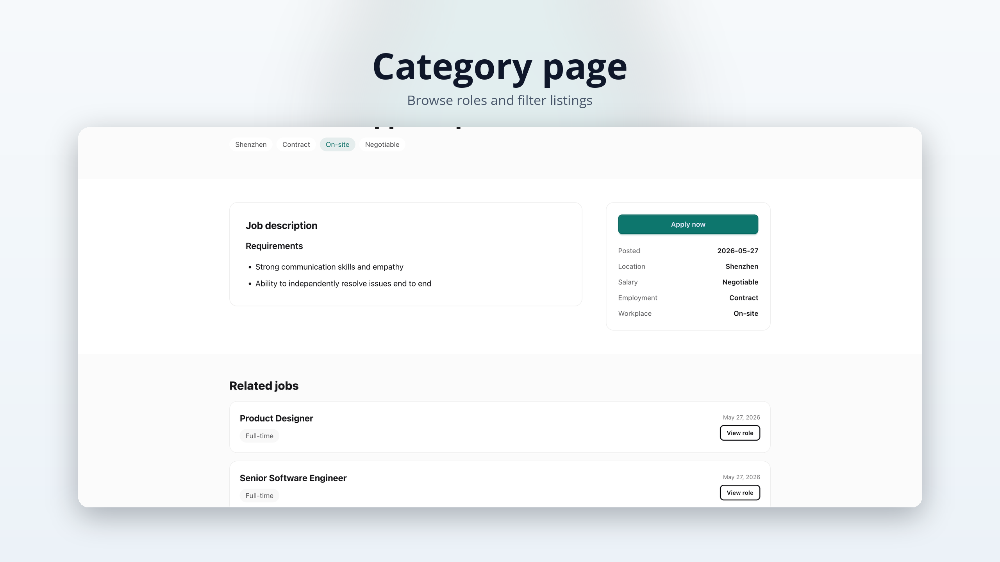
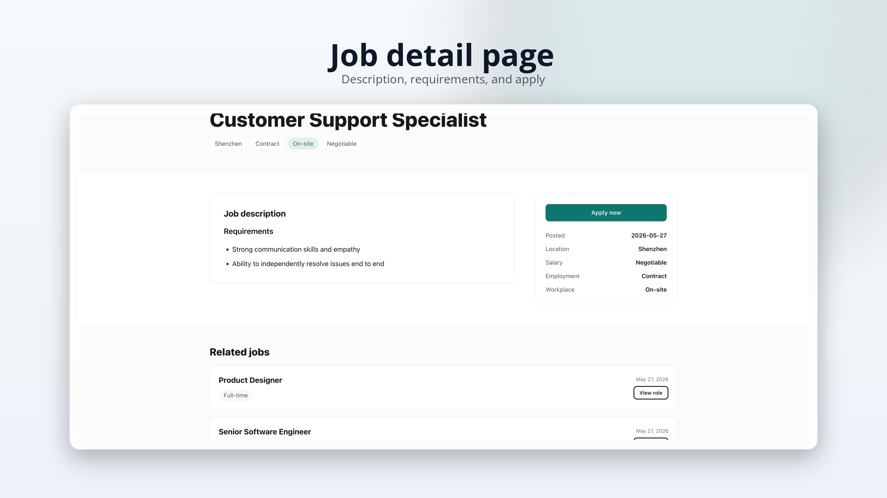
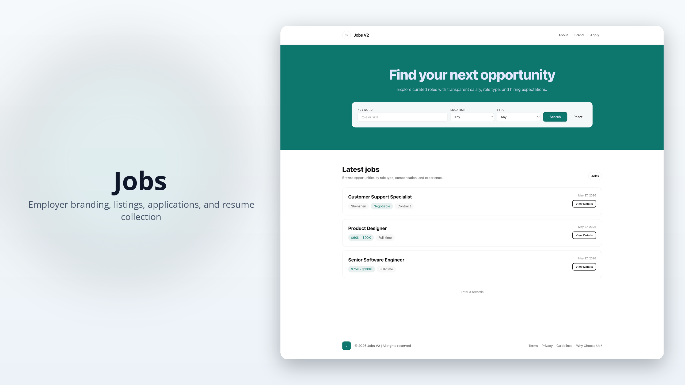
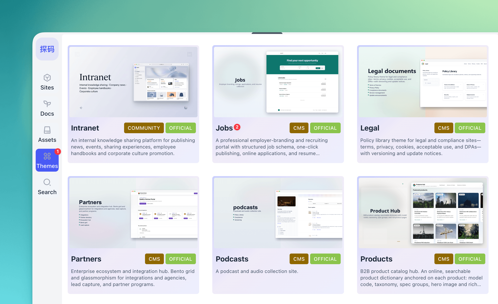
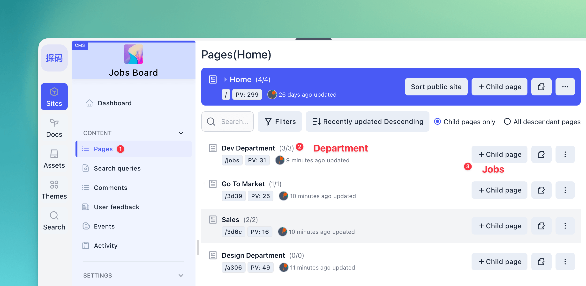
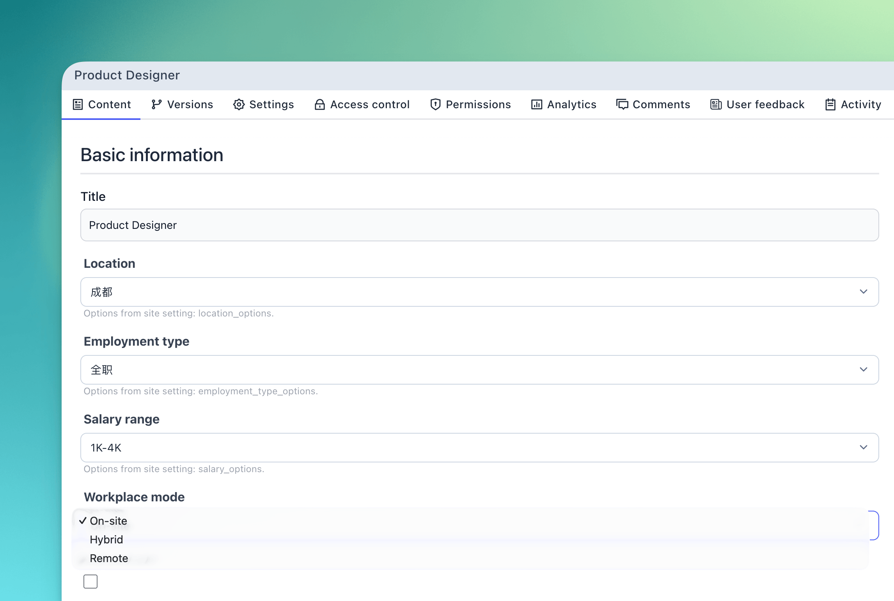
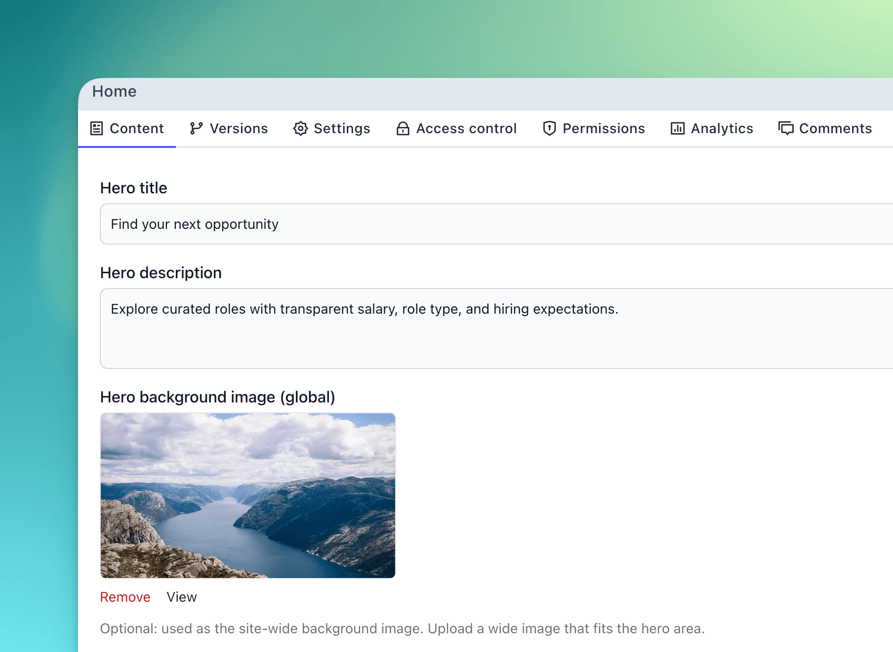

# Baklib CMS — Jobs theme

[简体中文](README.zh-CN.md) | English

This is a recruiting site (identifier `jobs`, scope cms). Use it for job groups and open roles. Skip it for an events site or a knowledge base.

| File | Read it to learn |
| --- | --- |
| [docs/README.md](docs/README.md) | Index of the docs |
| [docs/overview.md](docs/overview.md) | What it is, and when to use it |
| [docs/structure.md](docs/structure.md) | Home, job groups, and roles |
| [docs/schema.md](docs/schema.md) | Field ids, and which ones are writable |
| [docs/usage.md](docs/usage.md) | How to set the site up |
| [docs/activation.yml](docs/activation.yml) | Get-started arrangement recipe |

A lightweight **recruiting portal / employer branding / job board** theme for Baklib-powered sites. It ships with structured job posts (location, employment type, salary, workplace mode), department/channel listing, online application forms, and Tailwind CSS–based styling.

Template Git URL: https://github.com/baklib-templates/jobs

---

## Features

Repository Layout

| Path                          | Purpose                                                         |
| ----------------------------- | --------------------------------------------------------------- |
| `templates/`                  | Page templates                                                  |
| `snippets/`                   | Partials / Snippets                                             |
| `layout/`                     | `theme.liquid` site shell                                       |
| `config/settings_schema.json` | Theme settings schema                                           |
| `locales/`                    | UI strings (`*.json`) and schema translations (`*.schema.json`) |
| `seeds/`                      | Sample site and pages (default **English**)                     |
| `assets/`                     | Built CSS/JS                                                    |
| `src/`                        | Source for Tailwind and JS                                      |

---

- **Home** (`templates/index.liquid`): homepage supporting job search, department/category navigation, job listings, and featured job recommendations.
- **Department / Channel** (`templates/channel.liquid`): lists all roles under a specific category, supporting multi-criteria filtering by location, employment type, and salary.
- **Job Post Page** (`templates/page.liquid`): displays role details (location, salary, employment type, workplace mode), skill tags, responsibilities, requirements, and an application form.
- **Search** (`templates/search.liquid`), **tag listing** (`templates/tag.liquid`).

---

## Preview

|             Home (Job Board)              |              Department / Channel              |
| :---------------------------------------: | :--------------------------------------------: |
|  |  |
|             **Job Post Page**             |             **Cover (Thumbnail)**              |
|    |      |

---

## Installation

Find "Jobs" in the Baklib template marketplace, click install, and it's done.

|                 1. Select and Install Theme                 |                      2. Add Channels and Jobs                      |
| :---------------------------------------------------------: | :----------------------------------------------------------------: |
|  |  |
|                  **3. Job Post Settings**                   |                  **4. Home Page Configurations**                   |
|   |      |

---

## Other Documents

- Chinese Overview: [README.zh-CN.md](./README.zh-CN.md)
- Theme Help: [www.baklib.ai/themes](https://www.baklib.ai/themes/jobs)
